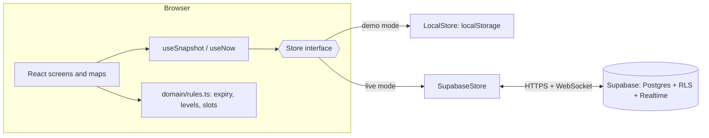

# CampusSpot

Live availability of **parking**, **library study spaces (ILS)** and the **library café** at IBA Karachi.
HCI final project, Phase 2 prototype. A student opens the app and sees, before walking anywhere, where there is room.

| Space | Who updates it | What the student sees |
| --- | --- | --- |
| Library café (4 tables, 16 chairs) | Café staff, signed in | Red/green chairs, like choosing seats on a plane |
| Library ILS (ground floor and 1st floor, 86 desks) | Students, anonymously | Grey (not reported), red (marked taken), green (reported free) |
| Library collab rooms 1 and 2 | Library staff | One-hour slots from 8:30 am to 7:30 pm, booked or open |
| Parking under shade (124 spaces) | Drivers log a start and end time | Each taken space shows when it should free up |

## Run it

```bash
npm install
npm run dev        # http://localhost:5173
npm test           # unit tests for the rules and the data layer
npm run build      # type-check and production build into dist/
```

With no configuration the app runs in **demo mode**: sample data, a demo clock (starts at 11:20 am so it looks the same at any hour) and a "staff" switch on the Staff page. Open the app in two tabs of the same browser and change a café chair in one: it changes in the other. That is a demo only. To make it live for everyone, follow the next section.

## Make it live (Supabase)

The barista toggles a chair on their phone and every student's screen updates. This needs a small hosted database, which is what Supabase provides on its free plan.

1. Create a free project at <https://supabase.com> (any region; pick one close to Karachi if offered).
2. **SQL Editor → New query**, paste all of `supabase/schema.sql`, **Run**. This creates the tables, the security rules and turns on realtime.
3. **Authentication → Users → Add user**: create the barista's login (email and password, tick *Auto Confirm User*). Do the same for any library staff.
4. **SQL Editor**: edit the email in `supabase/make-staff.sql` and run it. Only accounts listed in the `staff` table can change café seats and room bookings.
5. **Project Settings → API**: copy the **Project URL** and the **anon public** key.
6. Copy `.env.example` to `.env.local` and paste them in. Restart `npm run dev`. The header no longer says "Demo".
   Never use the `service_role` key anywhere in this project.

The free plan pauses a project after about a week with no activity. If the demo looks frozen, open the Supabase dashboard and press **Restore**.

## Put it on GitHub Pages

1. Create a repository and push this folder (see "Pushing to GitHub" below).
2. **Settings → Pages → Build and deployment → Source: GitHub Actions**.
3. **Settings → Secrets and variables → Actions → Variables**: add `VITE_SUPABASE_URL` and `VITE_SUPABASE_ANON_KEY` (these two values are public by design).
4. Move `github-pages-workflow.yml` to `.github/workflows/deploy.yml` (`mkdir -p .github/workflows && mv github-pages-workflow.yml .github/workflows/deploy.yml`), then push to `main`. The workflow runs the tests, builds and publishes. The site appears at `https://<your-username>.github.io/<repository-name>/`.

The app uses hash routes (`#/library/G`), so Pages needs no special redirect setup.

```bash
git init
git add .
git commit -m "CampusSpot Phase 2 prototype"
git branch -M main
git remote add origin https://github.com/<your-username>/<repository-name>.git
git push -u origin main
```

## Technology choices and why

| Choice | Why this and not something else |
| --- | --- |
| **React 19 + TypeScript** | A prototype with many screens that all show the same live data. Components let the café map, the ILS map and the parking map share one set of rules. TypeScript catches mistakes in the layout and rules code at build time, which matters because the numbers (124 spaces, 86 ILS) must match the sketches. |
| **Vite** | Starts instantly and builds to plain static files, so the whole app can be hosted for free on GitHub Pages. |
| **Plain CSS with design tokens** | Matches the IBA app look (maroon, rounded cards) with a dark theme, and avoids a component library the team would have to learn. |
| **Supabase (PostgreSQL, Realtime, Row Level Security, Auth)** | The barista's change must reach every student's phone within a second or two. Supabase gives a real database, push updates over WebSockets, and a login for staff without writing a server. It is free at this scale. *Alternative considered: Firebase.* It is also free and realtime, but its rules language and non-relational data are harder to explain and to test, and a relational schema suits "one row per desk". |
| **Row Level Security instead of a custom server** | The rules "students can read, only staff can change the café" live in the database, so a modified browser cannot bypass them. See `supabase/schema.sql`. |
| **No router library** | Five screens and hash routes. A 15-line hook is easier to explain than a dependency. |
| **Vitest** | Same tool as Vite, no extra setup. Tests cover the rules and the data layer. |
| **GitHub Pages + Actions** | Free hosting, and every push is tested and deployed. |

### Architecture



The screens only know the `Store` interface (`src/data/store.ts`). Swapping the demo store for Supabase changes no screen code, which is also how the unit tests run without a server.

## How the design follows the sketches

All geometry lives in `src/domain/layout.ts` and the tests check the totals.

- **Parking, 124 spaces.** Zones A, B, C: 6 boxes each, 4 spaces per box (24 spaces per zone). Zone D: 14 single spaces along the top and 14 along the bottom (28). Zone E: 12 boxes, 2 spaces per box (24).
- **Library ground floor, 68 ILS.** Row A: 9 boxes of 4. Column B: 8 boxes of 4. Two collab rooms.
- **Library 1st floor, 18 ILS.** Row C: 9 boxes of 2. The area below the row is an open void.
- **Walls, dividers, partitions.** The two ends of a row or column are walls. Lines between boxes are dividers. Each divider has desks on both sides, in pairs, with a partition between the two desks. On the ground floor that is 2 desks per side (4 per box); on the 1st floor it is 1 desk per side (2 per box).

## Rules the app applies

| Rule | Value | Reason |
| --- | --- | --- |
| ILS "taken" mark expires | 2 hours | A student who forgets to tap "I have left" must not leave a desk red all day |
| ILS "free" report expires | 1 hour | Someone can sit down at any moment, so a free report goes stale faster |
| Parking released after end time | 10 minutes | People run late; the space shows amber ("past end time") first |
| Café data flagged as old | 30 minutes | Staff may be busy; the app says so instead of showing stale colours as fact |
| Status labels | Full at 0 free, Busy at a quarter or fewer, otherwise Available | Same rule for every space |
| One ILS and one parking space per device | enforced in the app | Stops one person marking many desks (see Limits) |

## HCI principles applied

| Principle | Where |
| --- | --- |
| Visibility of system status | Every screen shows the time and how old the data is; the café warns when it is stale; logged parking shows an end time |
| Consistency and standards (Jakob's law) | Round tables with chairs, red/green, like airline and cinema seat maps; the same status pills everywhere |
| Recognition over recall | Always-visible back button; floor dropdown; legend on every map |
| Minimalist design, low cognitive load | Shapes and colours do the work; detail only after a tap on a zone |
| Perceivable without colour | Taken chairs carry a cross; taken parking shows a time; mine has a thick outline; past end time is dashed |
| Fitts's law | Detail views use 44 px or larger targets; overview maps are only for choosing a zone |
| Error prevention | Stale warnings, mark expiry, undo for café bulk changes, stepper instead of free text for times |
| User control and freedom | "I have left", edit end time, cancel on every sheet |
| Honest uncertainty | Grey means *not reported*, never "free" |

## Limits (be upfront about these in the report)

- **Anonymous writes can be abused.** Anyone with the app can mark an ILS or log a space. The database checks that ids and times are valid, and the app allows one mark per device, but a determined person could script it. Fix options: Supabase anonymous sign-in with per-user limits, or IBA single sign-on inside the IBA app.
- **Parking logging cannot be forced by software.** The plan relies on a sign at the spaces asking everyone to log an end time. In the app, forgotten spaces release themselves 10 minutes after the logged end time.
- **Notifications work only while the app is open.** A real push notification needs to live inside the IBA app.
- **No real sensors.** The camera or sensor idea for ILS is not built. A planned third iteration would let a feed turn desks green or red automatically. Occupancy sensors are preferable to identifying cameras for privacy.
- **Café and library staff are manual.** Accuracy depends on the barista updating chairs.
- The estimate that hidden full-looking occupancy costs the café about Rs 6,000 per peak day is the barista's own estimate from the stakeholder meeting, not measured data.

## Project layout

```
src/
  domain/    layout.ts (the sketches as data), rules.ts (expiry, levels, slots), time.ts, types.ts
  data/      store.ts (interface), localStore.ts (demo), supabaseStore.ts (live), StoreContext.tsx
  maps/      CafeMap, LibraryOverview, ParkingOverview (SVG)
  screens/   Home, Cafe, Library, Parking, Staff
  components/ Shell, Toast, Sheet, Legend, Pill
supabase/    schema.sql (tables, policies, realtime), make-staff.sql
docs/        PHASE2.md (what the report should cover and where the evidence is)
```
